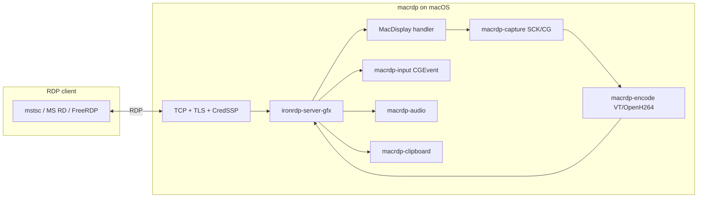

# Architecture

## High-level data flow

## Crate responsibilities

### `macrdp-server`

Standalone binary: loads TOML/`clap`, initializes tracing (stderr + `macrdp.log`), ensures TLS certs, checks permissions, builds `RdpServer` with `MacDisplay` and `MacInputHandler`, runs `server.run()` on Tokio.

### `macrdp-core`

Shared library extracted for the Tauri app:

- `start_server()` / `ServerHandle` — lifecycle on a dedicated OS thread (`RdpServer` is `!Send`)
- `ServerConfig` — serde TOML model shared with UI
- `ConfigUpdate` — hot reload: frame rate, bitrate, log level, cursor, resolution, encoder, chroma mode
- `ServerEventHandler` — metrics, connections, logs pushed to UI via `TauriEventBridge`
- `log_bridge` — tracing events forwarded to UI log stream
- `resolve_resolution()` — `auto` / `WxH` / legacy scale

### `macrdp-capture`

- **ScreenCaptureKit** stream for live frames (BGRA or NV12 `FrameData`)
- **CoreGraphics** path for lock-screen / fallback capture
- Permission helpers and display size detection:
  - SCK logical size → capture sizing
  - CG logical size → **mouse coordinate space** (must match `CGEvent`)
- `detect_display_scale()` for HiDPI / `resolution = "auto"`

### `macrdp-encode`

`VideoEncoder` trait:

- **VideoToolbox** (`VtEncoder`) — GPU, NV12 zero-copy, lower latency
- **OpenH264** — CPU, full P-frame support
- **AVC420** and **AVC444** (dual-stream via `yuv444_split`)
- Quality presets and adaptive bitrate via `bitrate_controller` (in core/display path)

### `macrdp-input`

- Scancode → macOS key mapping (`keymap.rs`)
- Mouse move, buttons, wheel (`CGEventCreateScrollWheelEvent2` with line units)
- Coordinate mapping is **not** in this crate alone — `MouseCoordMapper` in server handler maps RDP desktop coords → CG logical coords proportionally

### `macrdp-audio`

Factory implementing IronRDP sound server; captures system audio at configured rate/channels (default 48 kHz stereo).

### `macrdp-clipboard`

`cliprdr` factory: pasteboard sync, HTML, file transfer to cache dir under `~/Library/Caches/.../macrdp/clipboard` (or `/tmp`), size limits from config.

### Patched IronRDP crates

| Crate | Role |
|-------|------|
| `ironrdp-server-gfx` | GFX PDUs, H.264/Avc420/Avc444, **uncompressed ZGFX dirty rects**, capability negotiation in `gfx.rs` |
| `ironrdp-acceptor-patched` | Connection setup, CredSSP/NLA integration |

Workspace `[patch.crates-io]` redirects crates.io `ironrdp-server` and `ironrdp-acceptor` to these paths.

## Display pipeline (video)

1. Client negotiates GFX + H.264 (420 or 444).
2. `MacDisplay` runs a capture loop at `frame_rate`, optionally showing cursor.
3. For **small dirty regions**, an **uncompressed GFX path** sends ZGFX-wrapped bitmap updates instead of H.264 (threshold in `display.rs`).
4. Otherwise frames encode through hardware or software encoder; GFX state tracks surface size, pending ACKs, and keyframe policy.
5. **Bitrate** can be capped (`bitrate_mbps`) with adaptive adjustment; hot updates via `ConfigUpdate`.

## Security

- **Hybrid security**: TLS + CredSSP (NLA) so clients prompt for credentials
- Auto-generated self-signed TLS if paths omitted
- Credentials from config or ephemeral random pair printed once at startup
- No multi-user IAM — single configured RDP user/password model

## UI embedding vs CLI

| Aspect | CLI (`macrdp-server`) | UI (`macrdp-core::start_server`) |
|--------|----------------------|----------------------------------|
| Config | File search + `--config` | UI-managed TOML + `set_config` |
| Logging | stderr + `macrdp.log` | + `LogBridgeLayer` to frontend |
| Metrics | `--perf` summary on exit | Live dashboard / statistics DB |
| Threading | Tokio main runs server | Dedicated thread + async handle API |

## Known architectural tension points

Documented heavily in [upstream issue #2](./upstream-issues.md#issue-2-macos-26--gfx):

- `.cargo/config.toml` forces `DYLD_LIBRARY_PATH` for Swift 5.5 — breaks on newer macOS/Xcode combinations
- `Info.plist` `LSUIElement=true` + tray icon — libdispatch assertions on macOS 26
- `ironrdp-pdu` strict capability decode vs newer clients (V10_8+)
- H.264 pad width (16-align) vs surface width — possible client glitches
- Separate SCK vs CG coordinate spaces — intentional but easy to misconfigure when testing clients
